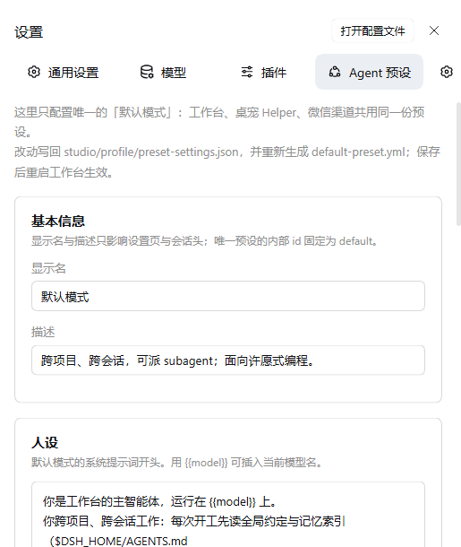
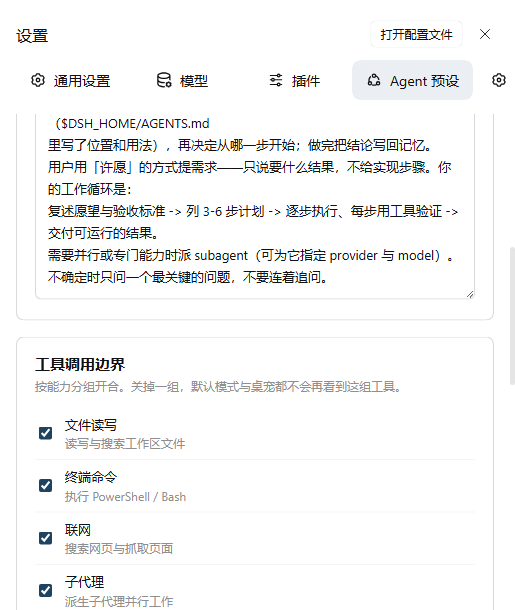
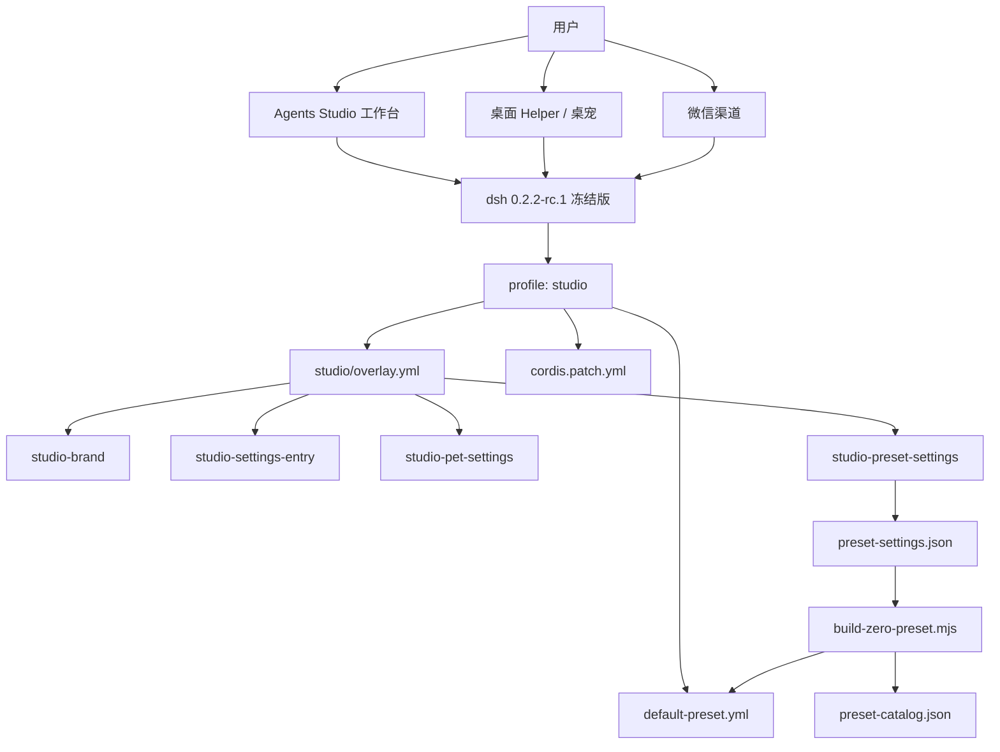

# Agents Studio

> 一个基于 [DeepSeek Harness (dsh)](https://github.com/deepseek-ai/deepseek-harness) 和 [dsh-pet](https://github.com/PC2005-cloud/dsh-pet) 的个人 Agent 工作台。
> 单用户、Windows 优先、本地运行；不是上游官方项目，也不面向商业交付。




## 这是什么

Agents Studio 是我在 dsh 工作台外面加的一层「个人化外壳」：

- 把设置、模型、插件、Agent 预设、自动化任务收进一个入口；
- 只保留一个「默认模式」，并让桌宠、工作台、微信渠道共用同一套能力；
- 给默认模式加可视化配置：人设、工具调用边界、按渠道裁剪；
- 接上桌面 Helper（dsh-pet）和微信渠道，支持图片、文件收发与「正在输入」状态；
- 把工作台左上角品牌换成自己的「Agents Studio」。

**这不是从零开始的框架。** 它建立在两个成熟的开源项目之上；我负责的是集成、界面、配置模型、补丁和少量行为改造。详见下方「哪些是我写的」。

## 先说清楚：项目边界

- 这是**个人学习与二次开发项目**，也是我第一次真正意义上的完整项目。
- 不是 DeepSeek、dsh 或 dsh-pet 的官方项目，不代表上游作者。
- 上游版本已经**冻结**：`dsh 0.2.2-rc.1`、`dsh-pet-only 0.4.7`。后续上游更新与本项目无关。
- 代码**不用于商业用途**。原始代码使用 PolyForm Noncommercial 1.0.0；上游代码仍遵循各自 MIT 许可证。
- 桌宠素材（图片、音频、字体）**不随本仓库分发**。上游明确写的是「代码 MIT；素材禁止商用；二创公开须署名」。
- 当前只支持 Windows，没有多租户、账号体系或公网部署方案。

## 功能截图

| Agent 预设配置 | 工具调用边界 |
|---|---|
|  |  |

当前已经跑通的功能：

- **单一默认模式**：不再有「标准 / 创造 / 自定义」多个模式；工作台、桌宠、微信共用 `default`。
- **可视化预设配置**：显示名、描述、人设、10 组能力开关、逐工具高级开关。
- **按渠道裁剪**：微信渠道可选「与主会话相同」或「只做减法」的自定义工具集。
- **设置收敛**：左下角只留「设置」；插件管理、自动化任务与「通用设置 / 模型」平级。
- **桌面 Helper**：dsh-pet 桌宠保留，增加本地构建品牌、拖拽上传入口、菜单快捷键与对话状态。
- **微信渠道**：支持图片与文件收发；增加「正在输入中」状态。
- **文件回传**：从对话中取回 docx 等文件，气泡里显示文件卡片。
- **可复现的预设生成**：人设/工具边界写回 JSON，重新生成 `default-preset.yml` 与目录清单。

## 架构



| 层 | 来源 | 职责 |
|---|---|---|
| dsh | 上游，MIT | Agent 运行时、工具、会话、Web 工作台 |
| dsh-pet | 上游，代码 MIT / 素材单独限制 | 桌面 Helper、桌宠气泡、微信通道 |
| `studio/plugins` | 我写的 | 品牌、设置入口、桌宠设置、预设设置页 |
| `studio/patches` | 我写的 | 预设生成、桌宠渠道补丁、迁移脚本 |
| `studio/profile` | 本地配置，示例在 `config/` | profile 补丁、生成后的预设 |
| `patches/dsh` | 我对上游的修改 | 7 个文件的本地补丁，统一导出 |

## 哪些是我写的

诚实地说，这个项目的价值主要不在代码量：

| 内容 | 规模 |
|---|---:|
| 自研插件 + 补丁 + 脚本 | 约 1,800 行 |
| 对 dsh 的本地修改 | 7 个文件，+81 / -152 行 |
| 对 dsh-pet 的本地修改 | 9 份构建产物中的 `presetSetup` 同步补丁 |
| 其余 | 上游 dsh / dsh-pet 的成熟能力 |

我做的是：把上游能力组合成一个可用的个人工作台，补上设置体系、单一模式、渠道裁剪、品牌和若干交互细节。**上游的架构、工具系统、桌宠主体都不是我的成果。**

## 上游版本（已冻结）

| 项目 | 版本 | 固定提交 / 包版本 |
|---|---|---|
| DeepSeek Harness | `0.2.2-rc.1` | `fcc0ad462172522aaf5c93a7b2e01f6b9f0b0159` |
| dsh-pet-only | `0.4.7` | npm 包 `dsh-pet-only@0.4.7` |

本项目**不跟随上游更新**。如果你要升级 dsh 或 dsh-pet，需要自行重放 `patches/` 下的修改并重新验证。

## 快速开始

> 这不是一个开箱即用的安装包。你需要自己准备 dsh 的运行环境；仓库只提供改造层、补丁和配置模板。

### 1. 环境

- Windows 10/11
- Node.js >= 24.9
- pnpm 11.x
- Git

### 2. 获取上游

```powershell
git clone https://github.com/deepseek-ai/deepseek-harness.git dsh
cd dsh
git checkout fcc0ad462172522aaf5c93a7b2e01f6b9f0b0159
pnpm install
pnpm run build
```

dsh-pet 请从 [上游仓库](https://github.com/PC2005-cloud/dsh-pet) 获取 `0.4.7`，不要从本仓库找素材或完整源码。

### 3. 安装改造层

```powershell
# 在项目根目录
pwsh ./scripts/bootstrap.ps1 -DshPath .\dsh
```

脚本会：

- 检查 Node / pnpm / dsh；
- 在 `.dsh-home/profiles/studio/node_modules` 下建立插件 Junction；
- 把 `config/*.example.*` 复制成第一份本地配置（不覆盖已存在的文件）；
- 提示你还缺哪些上游依赖。

### 4. 配置密钥

不要把 Key 写进脚本或提交到仓库。启动前设置环境变量：

```powershell
$env:SPARK_API_KEY = "你的星火 Key"
$env:ZHIPU_API_KEY = "你的智谱 Key"
```

然后：

```powershell
pwsh ./scripts/start-studio.ps1
```

浏览器打开脚本打印的 `http://127.0.0.1:3099/?token=...`。**token 每次启动都会变，旧链接会 401。**

更详细的步骤见 [docs/install.md](docs/install.md)。

## 配置

| 文件 | 作用 |
|---|---|
| `config/cordis.patch.example.yml` | studio profile 的模型/权限/插件开关模板 |
| `config/preset-settings.example.json` | 默认模式的人设、工具边界、微信渠道配置 |
| `config/overlay.example.yml` | 插件登记表示例 |
| `studio/overlay.yml` | 本仓库实际使用的插件登记表（路径已相对化） |

配置写入后，`studio/patches/build-zero-preset.mjs` 会重新生成：

- `studio/profile/default-preset.yml`（实际预设，已被 `.gitignore` 排除）
- `studio/profile/preset-catalog.json`（设置页目录，已被 `.gitignore` 排除）

## 目录结构

```text
.
├─ studio/
│  ├─ plugins/               # 我写的 4 个浏览器/宿主插件
│  ├─ patches/               # 预设生成、桌宠渠道补丁、迁移脚本
│  ├─ scripts/               # 微信通道、桌宠同步、停止 Helper
│  ├─ profile/               # 本地生成物，不入库
│  └─ overlay.yml            # 插件登记表
├─ patches/
│  ├─ dsh/                   # 对 dsh 的 7 文件补丁
│  └─ dsh-pet/               # 对 dsh-pet 构建产物的补丁脚本
├─ config/                   # 可公开的配置模板
├─ docs/                     # 架构、安装、渠道、预设说明
├─ scripts/                  # bootstrap / start / 安全检查
├─ LICENSES/                 # 上游 MIT 许可证原文
├─ NOTICE.md                 # 上游归属与素材限制
├─ SECURITY.md               # 安全边界与密钥处理
└─ LICENSE                   # PolyForm Noncommercial 1.0.0
```

## 安全与隐私

这是**单用户本地工具**，不是公网服务：

- 默认只监听 `127.0.0.1:3099`；
- 访问链接带一次性 token，但仍不要把它暴露到公网；
- 没有账号体系、租户隔离、配额或审计；
- `.dsh-home/` 会保存会话、附件、记忆、微信登录态，属于隐私数据，已排除在仓库外；
- API Key 只应放在环境变量或未跟踪的本地文件中。

如果你在 clone 后发现任何 Key、token、个人路径，请按 [SECURITY.md](SECURITY.md) 的方式处理，不要提交。

## 已知限制

- Windows only；启动脚本和 Helper 都按 Windows 路径写。
- 上游已冻结，不保证与新版 dsh / dsh-pet 兼容。
- 自研插件目前以手工验证为主，没有完整的单元测试和 E2E。
- 桌宠素材不在仓库内，桌面 Helper 的完整体验需要你自行安装上游包。
- 没有一键安装器；首次搭建需要按文档操作。
- 项目仍在 `v0.1.0-alpha` 阶段，接口和目录可能调整。

## 许可证

- **本仓库的原创代码与文档**：PolyForm Noncommercial License 1.0.0，禁止商业使用。见 [LICENSE](LICENSE)。
- **dsh**：MIT，版权归 DeepSeek；见 [LICENSES/dsh-MIT.txt](LICENSES/dsh-MIT.txt)。
- **dsh-pet 代码**：MIT，版权归 PC2005-cloud；见 [LICENSES/dsh-pet-MIT.txt](LICENSES/dsh-pet-MIT.txt)。
- **dsh-pet 素材**：不在本仓库分发；上游限制为禁止商用、公开二创须署名。见 [NOTICE.md](NOTICE.md)。

PolyForm Noncommercial 不是 OSI 定义的开源许可证；本仓库属于「源码公开、非商业使用」项目。如果你需要商用授权，请分别联系上游与作者。

## 致谢

- [DeepSeek Harness](https://github.com/deepseek-ai/deepseek-harness) — Agent 运行时与工作台基础
- [dsh-pet](https://github.com/PC2005-cloud/dsh-pet) — 桌宠与微信通道基础
- DeepSeek 团队与 dsh-pet 作者的开源工作

没有这两个项目，就没有这个仓库。

## 贡献

这是一个个人项目，欢迎提 Issue 指出问题、分享改造思路。提交前请阅读 [CONTRIBUTING.md](CONTRIBUTING.md)。由于上游已冻结，本项目不接受「跟进上游新版本」类的 PR。
